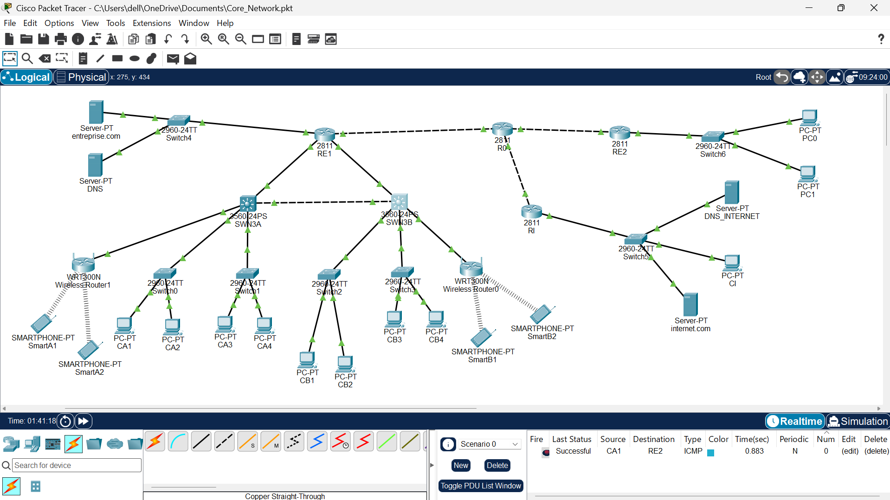
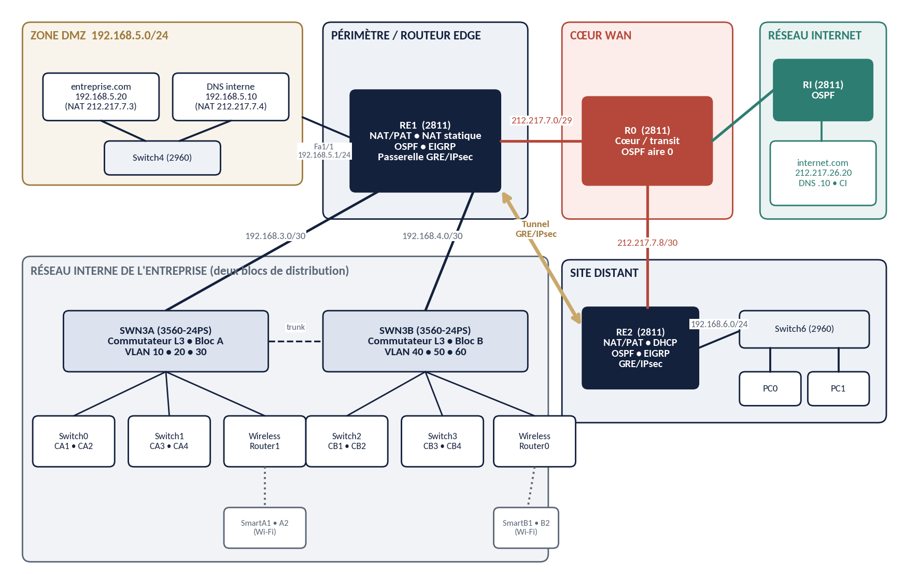
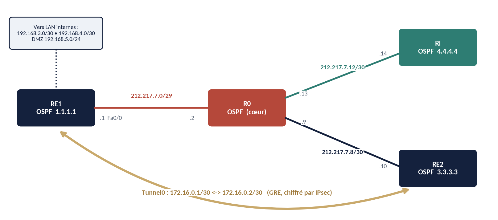
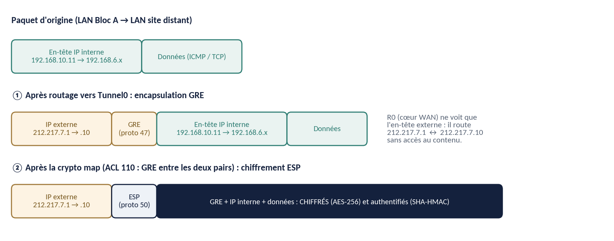
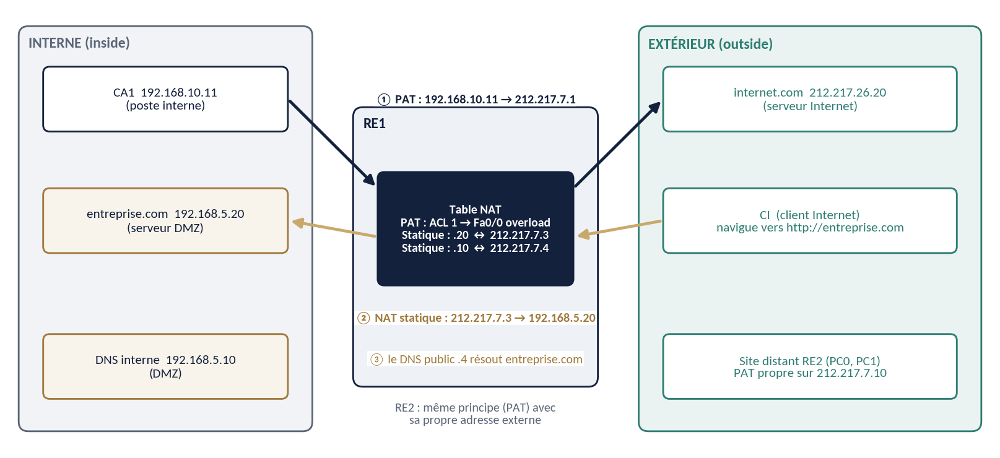

# Enterprise Network Core: DMZ, NAT and GRE over IPsec

A three-layer enterprise network designed, configured and validated in **Cisco Packet Tracer**: six VLANs across two distribution blocks, a DMZ published through static NAT, PAT for internal users, and a **GRE tunnel protected by IPsec (AES-256)** to a remote site, with OSPF on the WAN and EIGRP through the tunnel.

The project also documents what the network does **not** have (no firewall, no DMZ ACLs, no routing authentication). See [Security assessment](#security-assessment).



| | |
|---|---|
| **Author** | Ali Harti (Groupe ISGA) |
| **Tool** | Cisco Packet Tracer, source file `Core_Network.pkt` |
| **Platform** | Cisco 2811 routers (IOS 15.1), Catalyst 3560-24PS (L3) and 2960-24TT switches |
| **Report** | [`docs/`](docs/) (French, dated 22 October 2026) |
| **Status** | Finished. All 7 steps of the test plan pass |

## What it demonstrates

- **Hierarchical design** (core, distribution, access) with inter-VLAN routing on layer-3 switches
- **Segmentation**: VLAN 10/20/30 (block A), VLAN 40/50/60 (block B), DMZ `192.168.5.0/24`, remote LAN `192.168.6.0/24`
- **DMZ** on a dedicated router interface, published by **static NAT** (web `192.168.5.20` to `212.217.7.3`, DNS `192.168.5.10` to `212.217.7.4`)
- **PAT** on RE1 and RE2 for outbound traffic
- **Site-to-site VPN**: GRE tunnel over IPsec (IKE: AES-256, pre-shared key, DH group 2; ESP: AES-256 + SHA-HMAC)
- **Three routing mechanisms** in their proper role: static routes to the VLANs, OSPF area 0 on the WAN, EIGRP 100 through the tunnel
- **Infrastructure services**: DHCP on the distribution switches (6 pools) and on RE2, two DNS servers with split-horizon for `entreprise.com`, HTTP servers

## Architecture



| Zone | Network | Devices | Role |
|---|---|---|---|
| DMZ | 192.168.5.0/24 | Switch4, web server (.20), DNS (.10) | Exposed services, isolated from user LANs |
| Perimeter | 212.217.7.0/29 | RE1 | NAT/PAT, DMZ gateway, tunnel endpoint |
| WAN core | 212.217.7.0/29, .8/30, .12/30 | R0 | Transit router (OSPF) |
| Simulated Internet | 212.217.26.0/24 | RI, Switch5, DNS_INTERNET, internet.com, CI | Public side |
| Block A | VLAN 10, 20, 30 | SWN3A, Switch0, Switch1, Wireless Router1 | Users, gateways, DHCP |
| Block B | VLAN 40, 50, 60 | SWN3B, Switch2, Switch3, Wireless Router0 | Users, gateways, DHCP |
| Remote site | 192.168.6.0/24 | RE2, Switch6, PC0, PC1 | Reached by WAN and by the tunnel |

Device inventory: 4 routers (2811), 2 L3 switches (3560-24PS), 7 access switches (2960-24TT), 2 wireless routers (WRT300N), 4 servers, 11 PCs, 4 smartphones.

### WAN addressing and tunnel



| Device | Interface | Address |
|---|---|---|
| RE1 | Fa0/0 (to R0) | 212.217.7.1/29 |
| RE1 | Fa0/1 / Fa1/0 (to SWN3A / SWN3B) | 192.168.3.1/30 / 192.168.4.1/30 |
| RE1 | Fa1/1 (DMZ) | 192.168.5.1/24 |
| RE1 / RE2 | Tunnel0 | 172.16.0.1/30 / 172.16.0.2/30 |
| RE2 | Fa0/0 / Fa0/1 | 212.217.7.10/30 / 192.168.6.1/24 |
| RI | Fa0/0 / Fa0/1 | 212.217.7.14/30 / 212.217.26.1/24 |
| R0 (reconstructed) | to RE1 / RE2 / RI | 212.217.7.2/29, 212.217.7.9/30, 212.217.7.13/30 |

### GRE over IPsec



GRE gives a routable interface that carries EIGRP multicast. IPsec adds confidentiality. The WAN core only sees the outer header (`212.217.7.10` to `212.217.7.1`).

| Phase | Parameter | Value |
|---|---|---|
| IKE phase 1 | Encryption / auth / DH | AES-256 / pre-shared key / group 2 |
| IPsec phase 2 | Transform set `TS-GRE` | `esp-aes 256 esp-sha-hmac` |
| Traffic selector | ACL 110 | GRE between the two peers only |
| Tunnel | MTU | 1476 (1500 minus 24 bytes of GRE/IP headers) |

### NAT behaviour



| Source | Destination | Mechanism | Result |
|---|---|---|---|
| CA1 (VLAN 10) | internet.com | PAT on RE1 (212.217.7.1) | Works |
| CA1 (VLAN 10) | entreprise.com (DMZ) | Internal routing, no translation | Works |
| CI (Internet) | entreprise.com | Static NAT 212.217.7.3 to 192.168.5.20 | Works |
| PC0 (remote site) | internet.com | PAT on RE2 (212.217.7.10) | Works |
| PC0 (remote site) | Headquarters VLANs | GRE/IPsec tunnel, no NAT | Works |
| Internet | Private LAN hosts | No translation entry | Blocked by design |

## Validation

Layers were tested in order, stopping at the first failure.

| # | Test | Expected | Status |
|---|---|---|---|
| 1 | Core (R0): `show ip interface brief`, `show ip ospf neighbor` | Interfaces up/up, 3 neighbours FULL | Pass |
| 2 | Routing (RE1): `show ip route ospf`, pings | OSPF routes present, pings succeed | Pass |
| 3 | LAN to Internet: browse `internet.com` from CA1 | Page loads, CA1 translated to 212.217.7.1 | Pass |
| 4 | Internet to DMZ: browse `entreprise.com` from CI | Page loads, static entry 212.217.7.3 | Pass |
| 5 | Remote site: DHCP, ping, browse from PC0 | 192.168.6.x lease, Internet via PAT | Pass |
| 6 | **Regression**: `entreprise.com` from CA1 after WAN changes | DMZ still reachable | Pass |
| 7 | Tunnel: `show crypto isakmp sa`, `show crypto ipsec sa`, `tracert`, `show ip eigrp neighbors` | up/up, QM_IDLE, non-zero encrypt counters, EIGRP adjacency | Pass |

Strongest evidence for the tunnel: a `tracert` from PC0 to a headquarters VLAN returns `192.168.6.1`, `172.16.0.1`, `192.168.3.2`, destination. R0 never appears as a hop, so the core carries only encrypted packets. Encrypt/decrypt counters were non-zero on both ends (RE1 248/267, RE2 269/250).

> Packet Tracer shows `0 packets output` on `Tunnel0` even while traffic flows. This is a display quirk. The counters from `show crypto ipsec sa` are the reliable proof. Full test details: [`docs/test-plan.md`](docs/test-plan.md).

## Security assessment

**What it does well:** clear separation of functions and users, only two public addresses exposed, inter-site traffic encrypted and authenticated, routing contained (DMZ and remote LAN interfaces passive in EIGRP).

**What it lacks (documented, not hidden):**

| Gap | Impact |
|---|---|
| No firewall, no ACL on the DMZ | Every port of the published servers is reachable from outside. NAT hides addresses, it does not filter |
| Routing not authenticated | OSPF and EIGRP accept unauthenticated neighbours, so a rogue device could inject routes |
| No administration hardening | No console/VTY passwords, no `enable secret`, no SSH |
| Dated IKE parameters | DH group 2 (1024 bit), SHA-1 default, single pre-shared key |
| PAT ACL too wide | ACL 1 matches `192.168.0.0/16`, DMZ included |
| Layer 2 not hardened | No port security, DHCP snooping or trunk VLAN pruning |
| No redundancy | RE1 and R0 are single points of failure |
| Clear-text services | HTTP without TLS, DNS without DNSSEC |

Prioritised roadmap (DMZ ACLs and admin hardening first, then routing authentication and L2 hardening, then stateful firewall, redundancy and monitoring) is in the report, section 13.

## Repository layout

```
.
├── README.md
├── configs/            # per-device IOS configs (see notes below)
│   ├── RE1.txt         # perimeter: NAT, DMZ, tunnel, OSPF/EIGRP
│   ├── R0.txt          # WAN core (reconstructed, see note)
│   ├── RE2.txt         # remote site: DHCP, PAT, tunnel
│   ├── RI.txt          # simulated Internet router
│   ├── SWN3A.txt       # distribution block A (VLAN 10/20/30)
│   └── SWN3B.txt       # distribution block B (VLAN 40/50/60)
├── docs/
│   ├── Rapport_Projet_Reseau_et_Securite_Core_Network.docx
│   └── test-plan.md
└── images/             # topology and diagrams
```

## Configuration notes

- The **pre-shared key is masked** as `<PSK>` in `configs/RE1.txt` and `configs/RE2.txt`. Use the same value on both routers.
- **`R0.txt` is reconstructed** from the addressing plan, the default routes of RE1/RE2 and the OSPF statements applied during the build. The report flags the port assignment and router-id `2.2.2.2` as still to be confirmed with `show running-config` on R0.
- Access switches (Switch0 to Switch6) and the wireless routers are described in the report (section 7.6) but have no config file here.
- The lab was built in Packet Tracer, so these are not production-ready configs.

## Rebuild order

1. Place devices and cable them (straight-through vs crossover, report section 5.2)
2. Router interfaces and addresses, then `show ip interface brief`
3. OSPF area 0 on the WAN, check 3 FULL neighbours on R0
4. VLANs, trunks, SVIs, DHCP and default routes on SWN3A and SWN3B
5. Static routes and default route on RE1
6. NAT: ACL 1, PAT, two static entries, inside/outside interfaces
7. DMZ and servers, test `entreprise.com` from CA1 and CI
8. DHCP and PAT on RE2
9. Tunnel: ISAKMP, transform set, ACL 110, crypto map, Tunnel0 on both sides, check `QM_IDLE`
10. EIGRP 100 through the tunnel, check routes and the `tracert`
11. Run the full test plan, then `write memory` everywhere

## Lessons learned

- Validate by layers: links and OSPF, then NAT, then the tunnel last
- Run a regression test after every WAN change (the DMZ test is step 6)
- A tunnel that is up is not proof that it encrypts. Only the crypto counters and the `tracert` are
- A packet is translated only when it crosses an inside/outside boundary. Tunnel0 is neither, so tunnel traffic keeps its private addresses
- Capture configs after validation, check the prompt before capturing (a capture once showed R0 carrying the name RE1)

## Limits

Packet Tracer simulates device behaviour, not performance or every security feature of real hardware. The test plan checks functional connectivity, not resistance to attacks. There is no redundancy at core or distribution level.

## Author

Ali Harti, Groupe ISGA.
